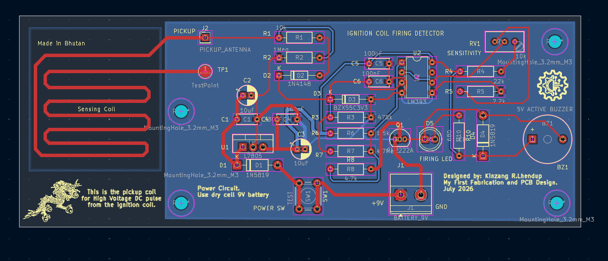

# Non-Contact Ignition-Coil Firing Detector

An educational automotive diagnostic tool that detects the electromagnetic transient produced when an ignition coil fires. The detector uses a PCB meander pickup conductor, an envelope detector, an LM393 comparator with adjustable sensitivity, and a transistor-driven LED and active buzzer.

The project is intended as a **firing-presence indicator** for coil-on-plug ignition systems, including the type commonly used in Maruti Suzuki, Hyundai and KIA vehicles. It does not measure secondary voltage or spark energy and cannot, by itself, prove that a coil is healthy under load.



## Project status

| Stage | Status |
| --- | --- |
| LTspice functional simulation | Completed; transient run verified on 18 July 2026 |
| KiCad schematic | Native KiCad 10.0 source imported and structurally checked; user-run ERC previously reported clean |
| PCB layout | Native KiCad 10.0 source imported and structurally checked; user-run DRC previously reported clean |
| Gerber generation | Not started |
| Physical prototype | Not built or validated |
| Vehicle testing | Not performed |

## Functional chain

```text
Ignition transient
      ↓ capacitive/electric-field coupling
PCB meander pickup
      ↓
10 kΩ protection + 1N4148 rectifier
      ↓
100 nF / 470 kΩ envelope detector + 3.3 V clamp
      ↓
LM393 adjustable-threshold comparator
      ↓
PN2222A driver
      ↓
Firing LED + 5 V active buzzer
```

## Verified LTspice baseline

The archived simulation uses:

- Input: `PULSE(0 3 10m 10u 10u 1m 100m)`
- Transient command: `.tran 0 500m 0 10u`
- Supply: 9 V input and LT1117-5 model
- Comparator: LM2903B/LM393-family model
- Threshold potentiometer parameter: `POS=0.5`
- Envelope network: 100 nF and 470 kΩ
- Clamp: 3.3 V Zener model

The simulation demonstrates correct downstream detection logic under an ideal 3 V pulse stimulus. It does **not** yet validate the amount of voltage that a real PCB pickup will obtain from a particular ignition coil or sensing distance.


See [simulation results](docs/simulation-results.md) for measured behaviour, convergence notes and limitations.

## Important baseline discrepancies

The current LTspice and KiCad designs are not exact copies:

1. LTspice uses an ideal pulse generator; KiCad uses J2 and a PCB meander pickup.
2. KiCad includes a raw-input bleed resistor; the LTspice baseline does not.
3. LTspice uses an LT1117-5; KiCad uses an L7805.
4. LTspice capacitor values `10m` mean 10 mF (10,000 µF), whereas the KiCad design uses practical 10 µF capacitors.
5. The TI `lm393.lib` model and matching custom `LM2903B.asy` symbol are included beside the `.asc` file. Their five-pin order has been checked for consistency.

These differences must be resolved in a later synchronized revision before PCB fabrication.

The comparator dependencies are now repository-contained. Before making the repository public, review the redistribution terms for the Texas Instruments model described in [third-party notices](THIRD_PARTY_NOTICES.md).

## Repository layout

```text
ltspice/       LTspice schematic and retained baseline log
kicad/         Native KiCad 10.0 project, schematic and PCB files
docs/          Design, simulation, PCB and test documentation
images/        Schematics, PCB view and simulation plots
bom/           Preliminary bill of materials
manufacturing/ Gerber and drill outputs after final review
```

## Safety

- Use the detector only as a non-contact instrument.
- Never connect the pickup directly to the ignition-coil secondary terminal or spark-plug high-voltage conductor.
- Keep hands, loose clothing, test leads and the PCB away from belts, fans and other moving or hot engine components.
- Use an insulated enclosure before vehicle testing.
- This is a development prototype, not a certified automotive diagnostic instrument.

## Author

Designed by **Kinzang R. Lhendup**  
First fabrication and PCB design project — July 2026  
Made in Bhutan
