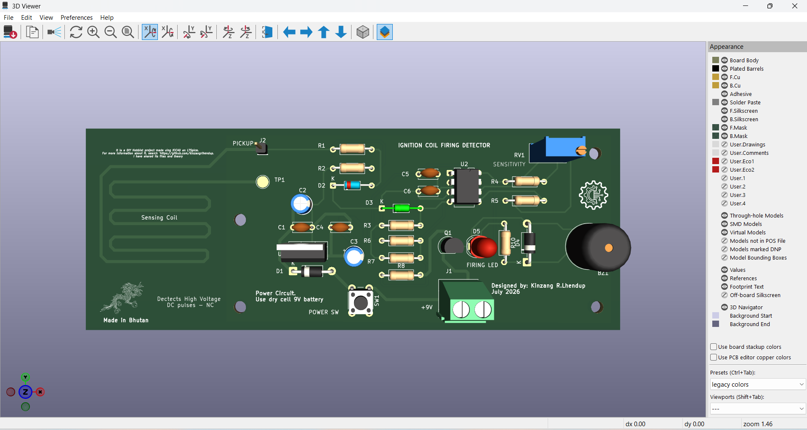
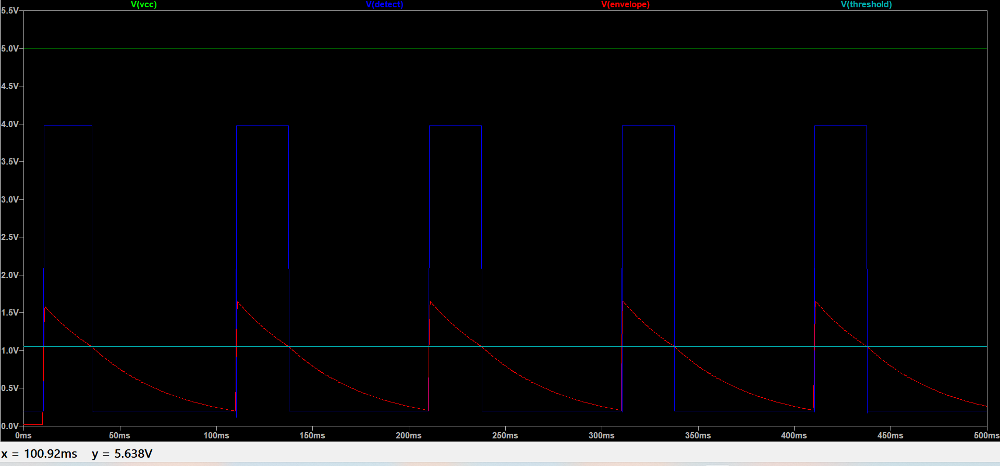

# Non-Contact Ignition-Coil Firing Detector

A development-stage, open-hardware automotive diagnostic tool that senses the electromagnetic transient produced when an ignition coil fires—without connecting directly to the high-voltage secondary circuit.

The detector combines a PCB meander pickup, input protection, an envelope detector, an adjustable LM393 comparator, and a transistor-driven LED and active buzzer.



[View the schematic](images/kicad-schematic.png) · [Read the circuit design](docs/circuit-design.md) · [Review the simulation](docs/simulation-results.md) · [See the PCB record](docs/pcb-design.md) · [Watch the 3D preview](media/kicad-3d-board-preview.mp4)

## What it does

The board is intended to indicate the **presence of ignition-coil firing** on coil-on-plug systems, including the types commonly used in Maruti Suzuki, Hyundai and KIA vehicles.

A positive indication means that the detector sensed a nearby transient. It does **not** measure secondary voltage, spark duration or spark energy, and it cannot by itself prove that a coil is healthy under cylinder pressure.

> **Development status:** The signal-conditioning and detection stages have been simulated, and the KiCad PCB and fabrication outputs have been prepared. A physical prototype has not yet been assembled, calibrated or tested on a vehicle.

## Design highlights

- Non-contact electric-field pickup using a front-copper PCB meander
- 10 kΩ input-current limiting and 1N4148 pulse rectification
- 3.3 V Zener clamp for comparator-input protection
- 100 nF / 470 kΩ envelope detector with a nominal 47 ms time constant
- Adjustable detection threshold using an LM393-family comparator
- Comparator hysteresis to reduce switching chatter
- PN2222A alarm driver
- Visual LED and audible 5 V active-buzzer indication
- 9 V battery input, reverse-polarity protection and regulated 5 V rail
- Through-hole, two-layer KiCad PCB intended for accessible prototype assembly

## Functional chain

```text
Ignition-coil transient
        ↓ capacitive/electric-field coupling
PCB meander pickup
        ↓
Protection and rectification
        ↓
Envelope detector and 3.3 V clamp
        ↓
Adjustable LM393 comparator
        ↓
PN2222A driver
        ↓
LED + active buzzer
```

## Project status

| Stage | Status |
| --- | --- |
| Circuit concept | Completed |
| LTspice functional simulation | Completed; transient baseline verified on 18 July 2026 |
| KiCad schematic | Completed; user-run ERC reported clean |
| PCB layout | Completed; user-run DRC reported clean |
| Gerber and drill generation | Completed and visually reviewed on 18 July 2026 |
| Physical assembly | Not started |
| Bench calibration | Not performed |
| Vehicle testing | Not performed |

Gerber and Excellon files are provided in [`manufacturing/gerbers/`](manufacturing/gerbers/) for design review and first-prototype fabrication. They should not be treated as production-validated outputs.

## Verified LTspice baseline

The archived transient simulation uses a 0–3 V ideal pulse stimulus at 10 Hz. Under the recorded test condition:

| Signal | Approximate result |
| --- | --- |
| Regulated supply | 5.002 V |
| Adjustable threshold | 1.04–1.05 V |
| Envelope peak | 1.60–1.65 V |
| Comparator output high | 3.95 V |
| Comparator output low | 0.15–0.20 V |
| Simulated load current | 22–23 mA when active |

Five correct detection events were observed during the 500 ms run.



The result verifies the downstream envelope, comparator and alarm-driver behaviour for the selected ideal input. It does not establish the signal amplitude that a real PCB pickup will receive from a particular ignition coil or sensing distance. Full results and interpretation are documented in [`docs/simulation-results.md`](docs/simulation-results.md).

## Repository guide

| Path | Contents |
| --- | --- |
| [`ltspice/`](ltspice/) | LTspice source, comparator model dependencies and retained solver log |
| [`kicad/`](kicad/) | Native KiCad 10 schematic, PCB and project files |
| [`docs/`](docs/) | Circuit explanation, PCB record, simulation results and test procedure |
| [`images/`](images/) | Schematics, PCB views and simulation plots |
| [`bom/`](bom/) | Preliminary bill of materials |
| [`manufacturing/gerbers/`](manufacturing/gerbers/) | Gerber job, copper, mask, silkscreen, outline and drill files |
| [`media/`](media/) | KiCad 3D board-preview video |

## Reviewing or reproducing the design

1. Read the [circuit-design notes](docs/circuit-design.md) and [known limitations](#known-limitations).
2. Open [`ltspice/09_final_ignition_coil_detector.asc`](ltspice/09_final_ignition_coil_detector.asc) to reproduce the archived functional simulation.
3. Open [`kicad/Ignition_Coil_Detector.kicad_pro`](kicad/Ignition_Coil_Detector.kicad_pro) in KiCad 10 to review the schematic and PCB.
4. Check every selected component against the [preliminary BOM](bom/bill_of_materials.csv), particularly footprint, pinout, polarity and voltage rating.
5. Refill copper zones and rerun ERC and DRC after any design change.
6. Re-export and independently inspect all Gerber and drill files before ordering a PCB.
7. Follow the staged [prototype testing procedure](docs/testing-procedure.md), beginning with unpowered inspection and a current-limited bench supply.

Proposed first-prototype construction: two-layer FR-4, 1.6 mm thickness, 1 oz copper, green solder mask and white silkscreen.

## Known limitations

- The LTspice baseline uses an ideal voltage pulse rather than a physical capacitive-coupling model.
- The simulation uses an LT1117-5 model, while the KiCad design uses an L7805.
- Two simulated supply capacitors are recorded as `10m` (10 mF in LTspice), whereas the PCB uses 10 µF parts.
- The PCB pickup sensitivity has not been measured against sensing distance, orientation or different coil constructions.
- Rejection of injector, alternator, starter-motor, relay and adjacent-coil interference has not been established.
- The design has not been validated for automotive load dump, thermal cycling, vibration, moisture or EMC compliance.
- Firing detection alone cannot identify every weak or load-dependent ignition-coil fault.

These points are documented so that simulation evidence is not mistaken for completed hardware validation.

## Planned next steps

- Synchronize the LTspice and KiCad power-supply implementations
- Model and sweep capacitive pickup coupling
- Verify purchased-component footprints and pinouts
- Assemble the first PCB prototype
- Characterize detection distance, orientation and sensitivity
- Test noise rejection and adjacent-coil selectivity
- Compare responses from multiple known-good and suspect ignition coils
- Document measured results and revise the design

## Safety

Automotive ignition systems can produce hazardous high-voltage pulses.

- Use this detector only as a non-contact instrument.
- Never connect the pickup to an ignition-coil secondary terminal or spark-plug conductor.
- Use an insulated enclosure before engine-bay testing.
- Keep the PCB, hands, clothing and test leads away from hot or moving engine components.
- Use suitable high-voltage precautions for any controlled bench ignition-coil test.
- Treat this project as an experimental prototype, not a certified diagnostic instrument.

## Feedback and contributions

Technical review, test results and constructive criticism are welcome. If you build or modify the design, please document the coil type, sensing distance, orientation, operating conditions and component changes so results can be compared meaningfully.

## Author

Designed by **Kinzang R. Lhendup**  
First PCB design and fabrication project · July 2026

## Citation and licence

If you refer to, reproduce or adapt this project, please cite:

> Lhendup, K. R. (2026). *Non-Contact Ignition-Coil Firing Detector* (Version 0.1.0) [Hardware design and simulation project]. GitHub. https://github.com/kinzangrlhendup/non-contact-ignition-coil-detector-hobby-project

Citation metadata is available in [`CITATION.cff`](CITATION.cff).

The original hardware design is licensed under [CERN-OHL-S-2.0](LICENSE). Please retain the attribution and notices required by the licence. The Texas Instruments comparator simulation model remains subject to its own terms, described in [`THIRD_PARTY_NOTICES.md`](THIRD_PARTY_NOTICES.md).
