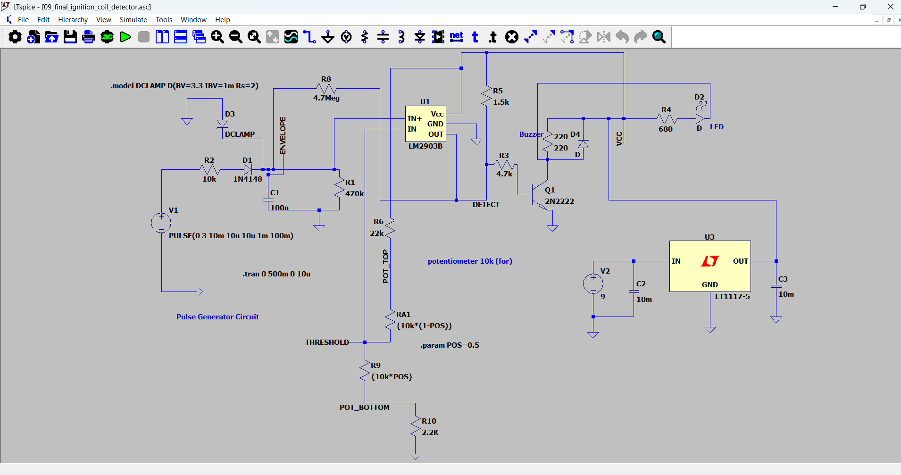

# Circuit design

## Purpose and scope

The circuit detects the transient electric field associated with ignition-coil firing and gives an audible and visual indication. It is a firing-presence detector rather than a calibrated secondary-voltage or coil-energy tester.



## 1. Pickup conductor

The KiCad PCB uses a snake/meander conductor on the front copper layer. J2 pin 1 connects the pickup net to the input conditioning circuit, and TP1 provides a test point. Copper-zone clearance is maintained around the complete meander, TP1 and feed trace to reduce unwanted capacitive loading.

The meander is not a tuned radio antenna. It behaves mainly as a capacitive electric-field pickup for the fast ignition transient. Its practical sensitivity depends on conductor area and length, distance and orientation relative to the coil, PCB dielectric and surrounding copper, enclosure material, coil construction, and ignition pulse rise time.

## 2. Input protection and rectification

The pickup feeds a 10 kΩ series resistor and a 1N4148 diode. The resistor limits transient current and the diode rectifies the received pulse. A 3.3 V Zener clamp protects the following comparator input against excessive positive voltage.

The KiCad version also shows a resistor from the raw pickup input to ground. Its final value should be validated experimentally; a higher value such as 4.7–10 MΩ loads the pickup less than 1 MΩ while still providing a DC and static-discharge path.

## 3. Envelope detector

The rectified signal charges a 100 nF capacitor. A 470 kΩ resistor discharges it between firing events.

The nominal time constant is:

```text
tau = R × C
    = 470 kΩ × 100 nF
    = 47 ms
```

This stretches a short received pulse into a voltage that the comparator can detect reliably.

## 4. Adjustable threshold

The LTspice threshold network contains a 22 kΩ upper resistor, a 10 kΩ potentiometer, and a 2.2 kΩ lower resistor. With `POS=0.5`, the simulated potentiometer is divided into 5 kΩ above and 5 kΩ below the wiper.

For a 5 V rail, the calculated midpoint threshold is approximately:

```text
Vthreshold = 5 × (5 kΩ + 2.2 kΩ) / (22 kΩ + 10 kΩ + 2.2 kΩ)
           ≈ 1.053 V
```

This agrees with the plotted value of approximately 1.04–1.05 V.

## 5. Comparator and hysteresis

An LM393-family open-collector comparator compares `ENVELOPE` with `THRESHOLD`. A 1.5 kΩ resistor pulls `DETECT` toward 5 V. The 4.7 MΩ feedback resistor provides a small amount of hysteresis to reduce chatter close to the threshold.

The simulated high level is about 3.95 V rather than 5 V because the output node also supplies PN2222A base current through the 4.7 kΩ resistor. Approximating the transistor base-emitter voltage as 0.7 V:

```text
Vdetect ≈ (5 × 4.7 kΩ + 0.7 × 1.5 kΩ) / (4.7 kΩ + 1.5 kΩ)
        ≈ 3.96 V
```

## 6. Alarm driver

The comparator drives a PN2222A through 4.7 kΩ. The transistor switches the active buzzer and firing LED. In the LTspice model, a 220 Ω resistor represents the buzzer load. A diode across the buzzer branch provides flyback/transient suppression, although an active piezo buzzer is generally much less inductive than an electromagnetic buzzer.

The 680 Ω LED resistor gives a nominal current of roughly 4–5 mA, depending on LED forward voltage.

## 7. Power supply

The physical design uses a 9 V battery, normally-open momentary TEST pushbutton, reverse-polarity protection diode and L7805 regulator with bulk and 100 nF decoupling capacitors.

The archived LTspice baseline instead uses an LT1117-5. Its two supply capacitors are entered as `10m`, which LTspice interprets as 10 mF. They must be changed to the intended value (likely `10u`) when synchronizing the simulation with the KiCad design.
