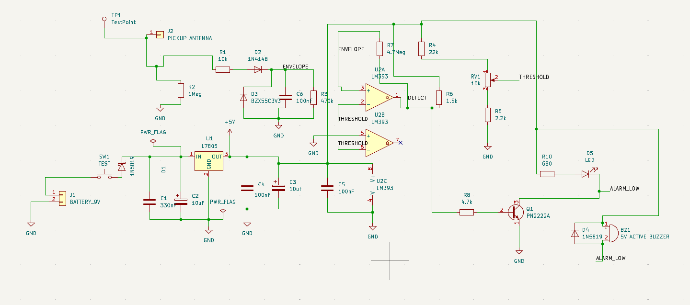
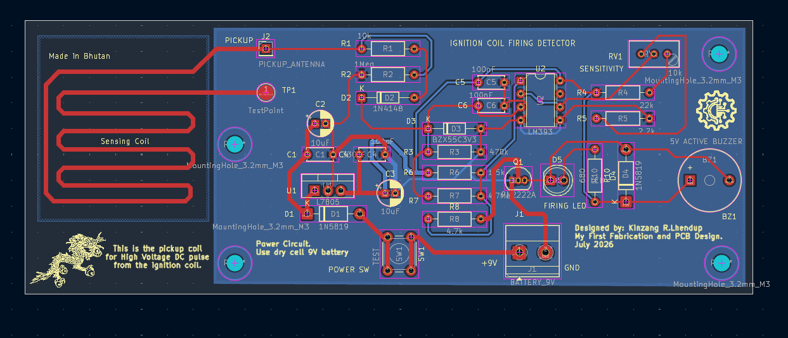

# PCB design record

## Current status

The native KiCad 10.0 `.kicad_pro`, `.kicad_sch` and `.kicad_pcb` files are imported into the repository. 
See [KiCad source validation](source-validation.md).

## Documented design decisions

- Two-layer PCB with a front-copper meander pickup.
- J2 connects the pickup conductor to the sensing circuit.
- TP1 provides access to the raw pickup signal.
- Ground copper is excluded beneath and around the meander, TP1 and pickup feed to reduce pickup loading.
- Four M3 mounting holes are provided.
- SW1 is intended to be a normally-open momentary TEST button for hold-to-test operation.
- Silkscreen identifies the sensing coil, power supply, sensitivity control, firing LED and active buzzer.

## Manufacturing defaults proposed for the first prototype

- Two copper layers
- FR-4, 1.6 mm thickness
- 1 oz copper
- HASL lead-free or ENIG finish
- Green solder mask
- White silkscreen

These are proposed prototype parameters and should be confirmed before ordering.
