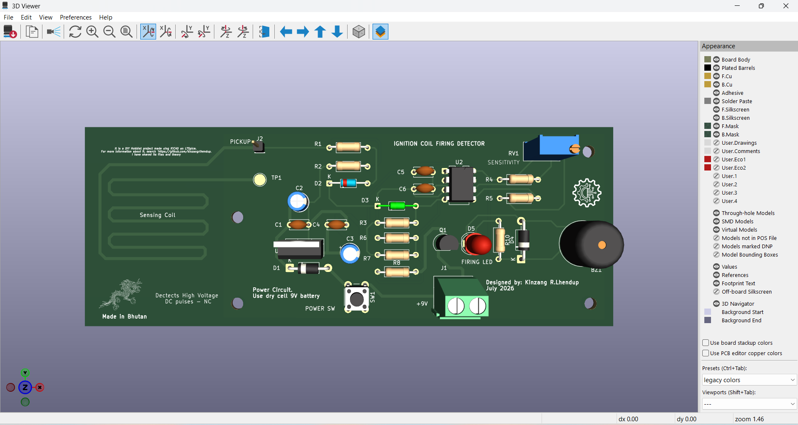

# PCB design record

## Current status

The native KiCad 10.0 `.kicad_pro`, `.kicad_sch` and `.kicad_pcb` files were imported into the repository on 18 July 2026. Structural checks confirmed valid project JSON and balanced schematic/PCB S-expressions. The user previously reported that the KiCad electrical-rules and design-rules checks completed without errors or violations.

The current automated environment does not include `kicad-cli`, so that earlier clean ERC/DRC result has not been independently rerun here. See [KiCad source validation](source-validation.md).

## Documented design decisions

- Two-layer PCB with a front-copper meander pickup.
- J2 connects the pickup conductor to the sensing circuit.
- TP1 provides access to the raw pickup signal.
- Ground copper is excluded beneath and around the meander, TP1 and pickup feed to reduce pickup loading.
- Four M3 mounting holes are provided.
- SW1 is intended to be a normally-open momentary TEST button for hold-to-test operation.
- Silkscreen identifies the sensing coil, power supply, sensitivity control, firing LED and active buzzer.
- Bhutanese graphics, designer credit and fabrication date are included on the front silkscreen.

## Native PCB inventory

- 29 electrical/component footprints
- Four board-only M3 mounting holes
- 207 routed copper segments
- Two copper zones
- No vias
- Through-hole component construction
- 1.6 mm board thickness setting

## Pre-fabrication review still required

- Confirm schematic-to-PCB synchronization.
- Confirm every footprint against the purchased part datasheet.
- Confirm electrolytic-capacitor, diode, LED, transistor, regulator and buzzer polarity.
- Confirm LM393 pin mapping and unused comparator treatment.
- Decide the final raw-input bleed resistance after sensitivity testing.
- Check silkscreen-to-pad clearance and text readability in the 3D Viewer.
- Refill copper zones and rerun ERC/DRC.
- Generate and inspect Gerber and drill files in an independent viewer.
- Before fabrication or public product distribution, add `Licensed under CERN-OHL-S v2` and the repository Source Location to a visible part of the product, packaging or accompanying documentation, as required by the project Notice and applicable licence terms.

## Manufacturing defaults proposed for the first prototype

- Two copper layers
- FR-4, 1.6 mm thickness
- 1 oz copper
- HASL lead-free or ENIG finish
- Green solder mask
- White silkscreen

These are proposed prototype parameters and should be confirmed before ordering.
