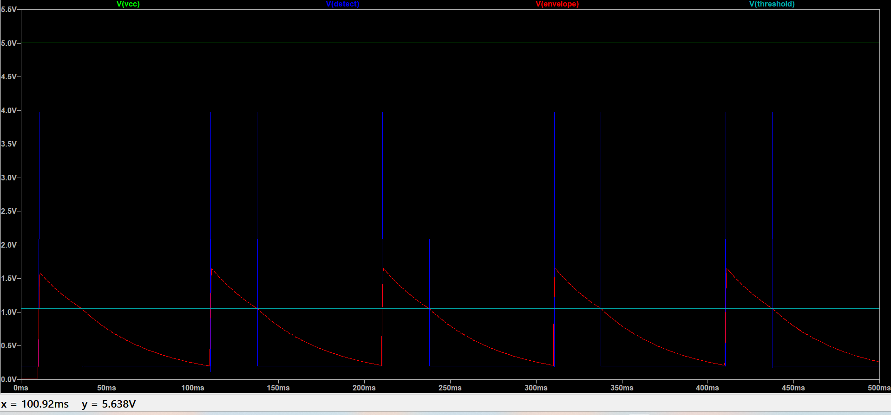
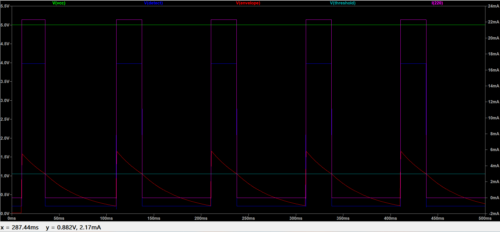
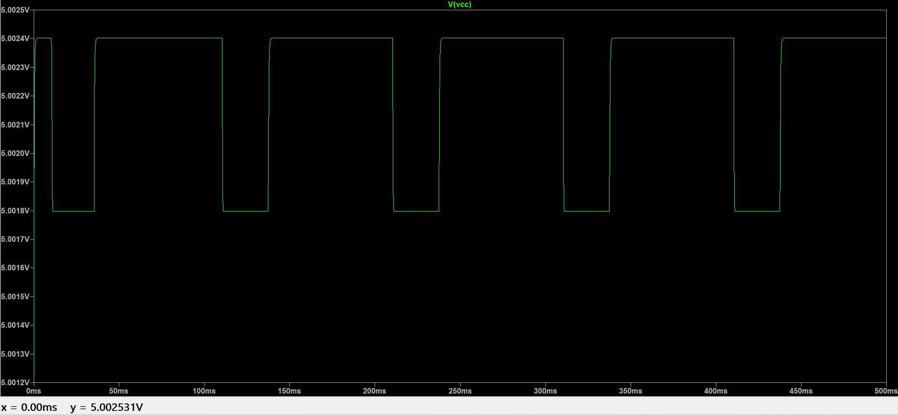

# LTspice simulation results

## Test record

| Item | Value |
| --- | --- |
| Test date | 18 July 2026 |
| LTspice version | 26.0.2 for Windows |
| Analysis | Transient |
| Stop time | 500 ms |
| Maximum time step | 10 µs |
| Input stimulus | 0–3 V, 1 ms pulse, 100 ms period |
| Pulse repetition rate | 10 Hz |
| Threshold-potentiometer setting | `POS=0.5` |

## Observed results

| Signal | Approximate result | Interpretation |
| --- | --- | --- |
| `V(VCC)` | 5.0018–5.0024 V after startup | Supply model remains effectively stable; about 0.6 mV peak-to-peak variation |
| `V(THRESHOLD)` | 1.04–1.05 V | Agrees with the resistor-divider calculation |
| `V(ENVELOPE)` | Peaks around 1.6–1.65 V and decays exponentially | Rectifier and RC network stretch each 1 ms input pulse |
| `V(DETECT)` high | Approximately 3.95 V | Comparator output releases and supplies transistor base current through the pull-up network |
| `V(DETECT)` low | Approximately 0.15–0.2 V | LM393-family open collector pulls the output low |
| `I(220)` | Approximately 22–23 mA when active | Simulated buzzer-equivalent load is switched successfully |

The output changes state once the envelope exceeds the threshold and returns low after the envelope falls below it. Five correct detection events appear during the 500 ms run.







## Envelope timing check

With a 470 kΩ discharge resistor and 100 nF capacitor, the nominal time constant is 47 ms. Starting from a 1.6 V envelope peak, the ideal decay time to a 1.05 V threshold is:

```text
t = tau × ln(Vpeak / Vthreshold)
  = 47 ms × ln(1.6 / 1.05)
  ≈ 20 ms
```

The plotted detection window is consistent with this order of magnitude once the 1 ms charging pulse and comparator behaviour are included.

## Solver log

The simulator completed the transient analysis in approximately 11.5 seconds. Direct Newton iteration and Gmin stepping did not find the initial operating point; LTspice then used source stepping successfully. This is a convergence note, not a failed transient run.

The retained log is available at `ltspice/results/09_final_ignition_coil_detector.log`. Its user-specific Windows home-directory prefix has been replaced with `%USERPROFILE%` for safe publication; the solver messages and timing remain unchanged.

## What this simulation proves

- The envelope detector responds to the chosen ideal pulse.
- The adjustable comparator threshold operates correctly at the simulated setting.
- The open-collector pull-up and PN2222A driver switch the load.
- The modelled 5 V rail remains steady during the chosen load events.

## What this simulation does not prove

- The actual voltage induced in the PCB meander at a given distance from a real coil.
- Reliable performance across different Maruti Suzuki, Hyundai or KIA coil constructions.
- Immunity to injector, alternator, relay, starter-motor and other engine-bay interference.
- Detection of weak spark energy, a shorted turn, insulation breakdown or failure under cylinder pressure.
- Thermal, vibration, moisture, reverse-battery, load-dump or automotive EMC robustness.

## Required next simulation revision

1. Synchronize the regulator and capacitor values with KiCad.
2. Add the KiCad input bleed resistor.
3. Replace or supplement the ideal voltage source with a capacitive-coupling pickup model.
4. Sweep input amplitude, pulse width, repetition rate and threshold-potentiometer position.
5. Run sensitivity and noise-rejection cases.
6. Retain the original baseline file unchanged and save the synchronized version under a new revision filename.

## Reproducibility dependencies

The repository now includes the exact `LM2903B.asy` symbol and `lm393.lib` model used by the baseline simulation. Their five-pin order was checked against the `.SUBCKT` declaration and found consistent. The uploaded files were preserved byte-for-byte.
